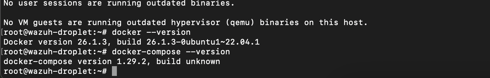
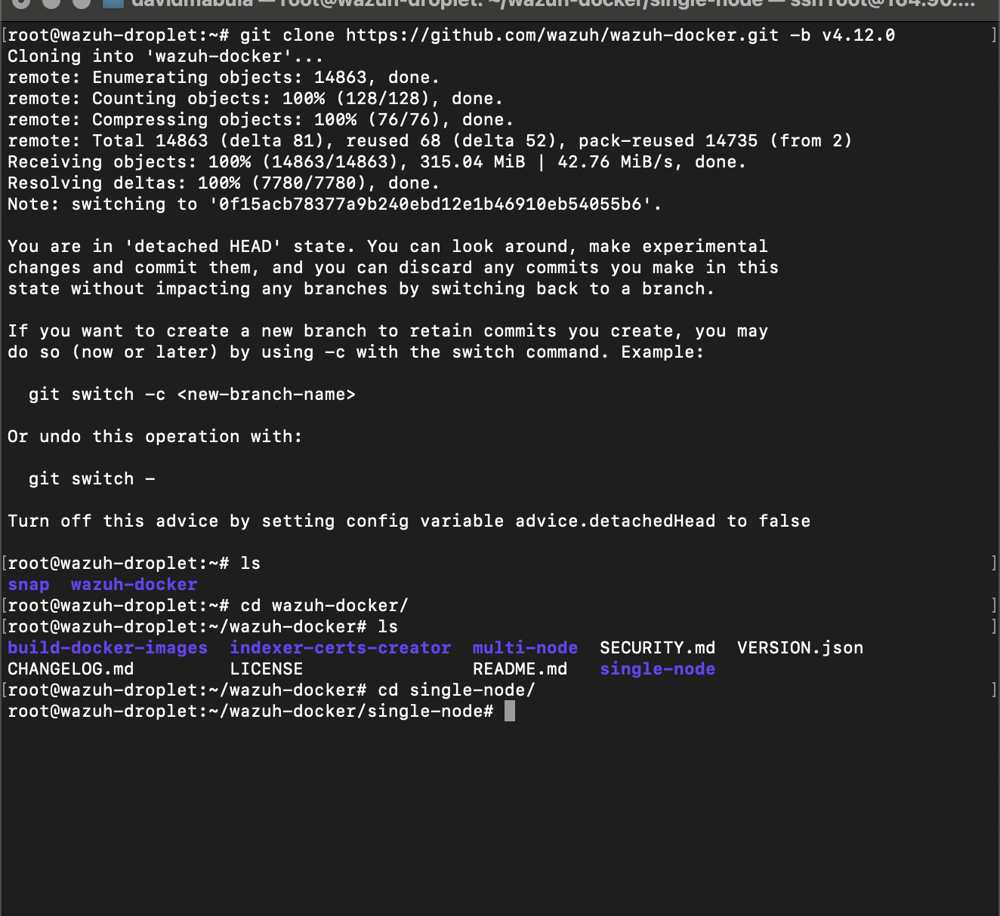
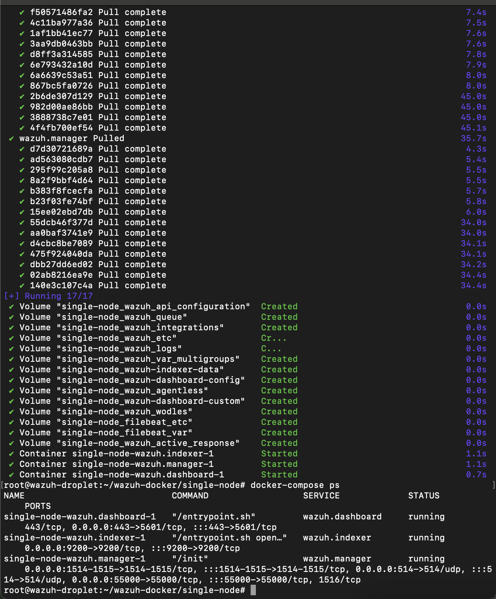
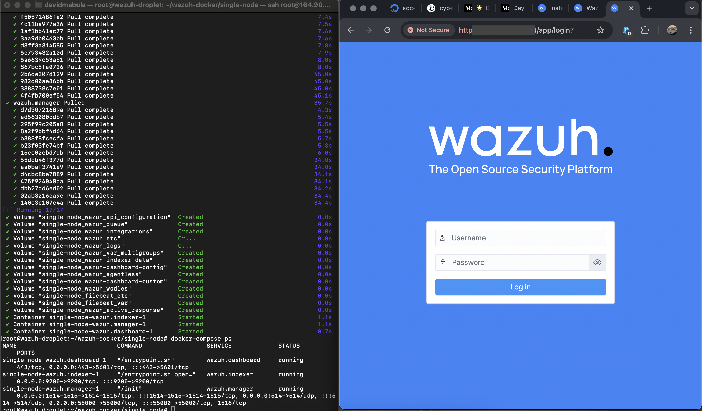
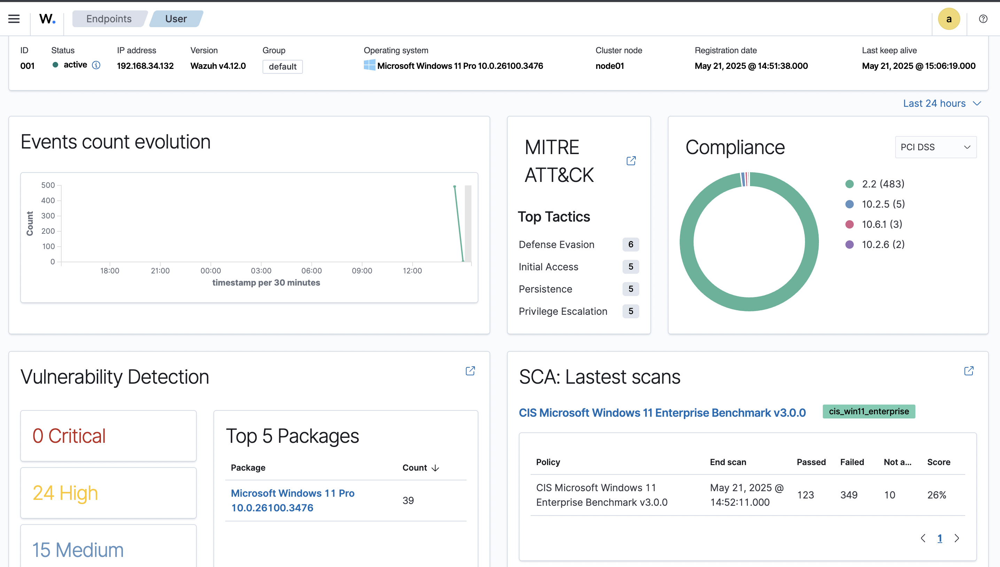
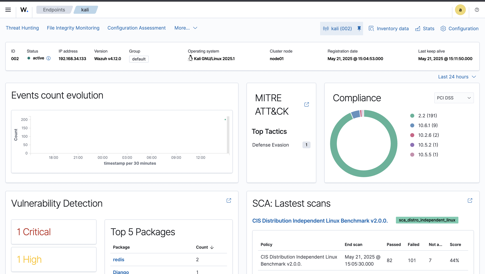
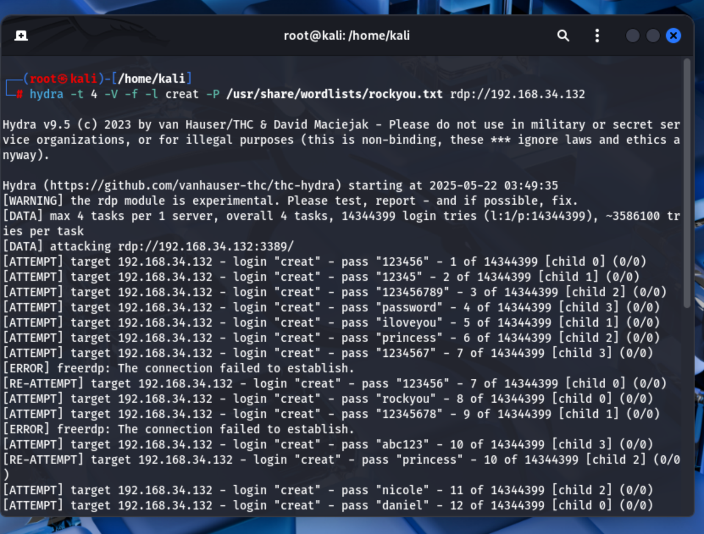
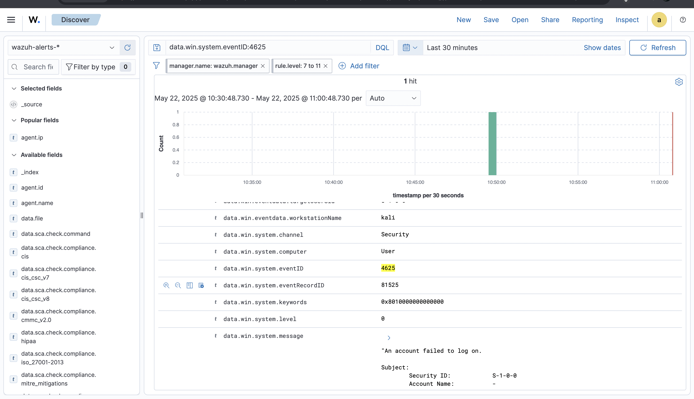
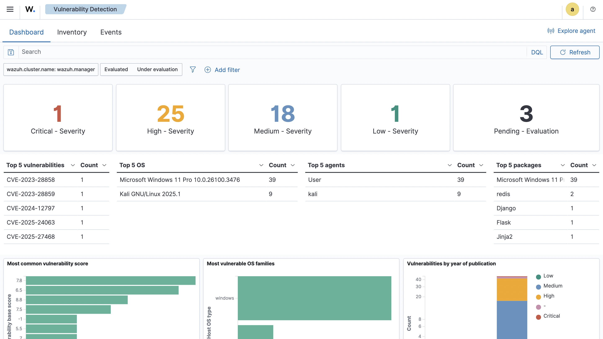

# Building a SOC Lab: Day 1 – Deploying Wazuh SIEM and Simulating Brute-Force Attacks

## 🛡️ Introduction

As a cybersecurity enthusiast and aspiring SOC analyst, I'm documenting my journey to build a complete Security Operations Center (SOC) environment using open-source tools. This series will demonstrate the core technologies involved in detecting, analyzing, and responding to threats in a real-world setup.

Wazuh is a robust, free, open-source Security Information and Event Management (SIEM) and Extended Detection and Response (XDR) platform. It provides real-time visibility into IT infrastructure by aggregating, analyzing, and correlating security data from endpoints, servers, and cloud environments. Wazuh aids organizations in threat detection, integrity monitoring, and compliance management.

## 🖥️ Lab Environment Overview

### Server:
- **Wazuh Server**: DigitalOcean Droplet (Ubuntu 22.04)

### Agents:
- **Windows 11 VM**: VMware Workstation
- **Kali Linux VM**: VMware Workstation

### Network Configuration:
- Both VMs are set to NAT mode for seamless communication with the Wazuh server

## 🛠️ Deployment Procedure

### 1. Deploying Wazuh Server (Docker)

#### Prerequisites: Install Docker and Docker Compose

```bash
curl -sSL https://get.docker.com/ | sh
systemctl start docker
curl -L "https://github.com/docker/compose/releases/download/v2.12.2/docker-compose-$(uname -s)-$(uname -m)" -o /usr/local/bin/docker-compose
chmod +x /usr/local/bin/docker-compose
```

Verify installation:

```bash
docker --version
docker-compose --version
```



#### Clone Wazuh Docker Repository

```bash
git clone https://github.com/wazuh/wazuh-docker.git -b v4.12.0
cd wazuh-docker/single-node
```



#### Deploy Wazuh Containers

```bash
docker-compose up -d
```



#### Access Wazuh Dashboard

- URL: `https://<your_droplet_ip>`
- Default Credentials:
  - Username: `admin`
  - Password: `SecretPassword`



### 2. Installing Wazuh Agent on Windows 11 VM

- Download the installer from the Wazuh website
- Follow installation prompts
- Configure Agent by entering the Wazuh server IP during setup
- Open Wazuh Agent Manager to confirm the agent is running



### 3. Installing Wazuh Agent on Kali Linux

```bash
# Install the GPG key
curl -s https://packages.wazuh.com/key/GPG-KEY-WAZUH | gpg --no-default-keyring --keyring gnupg-ring:/usr/share/keyrings/wazuh.gpg --import && chmod 644 /usr/share/keyrings/wazuh.gpg

# Add the repository
echo "deb [signed-by=/usr/share/keyrings/wazuh.gpg] https://packages.wazuh.com/4.x/apt/ stable main" | tee -a /etc/apt/sources.list.d/wazuh.list

# Update package information
apt-get update

# Deploy Wazuh Agent
WAZUH_MANAGER="<IP ADDRESS of Wazuh Manager>" apt-get install wazuh-agent

# Enable and start Wazuh services
systemctl daemon-reload
systemctl enable wazuh-agent
systemctl start wazuh-agent
```



### 4. Enabling Remote Desktop Protocol (RDP) on Windows VM

- Navigate to Settings > System > Remote Desktop
- Enable the feature
- Configure Firewall:

```powershell
netsh advfirewall firewall add rule name="Allow RDP" dir=in action=allow protocol=TCP localport=3389
```

- Verify RDP service is active using an NMAP scan to ensure port 3389 is listening

## 🔥 Simulating Brute-Force Attack Using Hydra

To test Wazuh's detection capabilities, I simulated a brute-force attack from Kali Linux targeting the Windows VM:

```bash
hydra -t 4 -V -f -l <Username> -P /usr/share/wordlists/rockyou.txt rdp://<Windows VM IP Address>
```

Parameters used:
- `-t 4`: Limit to 4 parallel connections
- `-V`: Verbose mode
- `-f`: Stop upon successful login
- `-l creat`: Username to attack
- `-P`: Password file to use



## 📊 Results and Detection

Wazuh successfully detected the brute-force attack attempt:

- Windows logs captured multiple failed login attempts (Event ID 4625)
- Wazuh dashboard displayed the security alerts in real-time
- Attacks were properly categorized by severity levels




## 📌 Summary of Achievements

- Successfully deployed Wazuh SIEM on DigitalOcean using Docker
- Installed and configured Wazuh agents on both Windows 11 and Kali Linux VMs
- Enabled RDP and simulated a brute-force attack using Hydra
- Observed alert generation in Wazuh dashboard in real time
- Gained practical experience with SIEM deployment and configuration

## 🔍 What's Next

In the upcoming parts of this series, I'll deploy and integrate:

- TheHive (case management and investigation)
- Cortex (observable analysis and automation)
- MISP – Malware Information Sharing Platform and Threat Sharing

These tools will be integrated with Wazuh to complete the detection, investigation, and response cycle just like a real SOC environment.

Stay tuned for Day 2! 