# Building a SOC Lab: Episode 3 – Integrating Wazuh SIEM with TheHive for Automated Alert Management

## 🛡️ Introduction

Following the deployment of Wazuh (Day 1) and the incident response platforms TheHive, Cortex, and MISP (Day 2), Day 3 focuses on integrating Wazuh SIEM with TheHive. This automates forwarding Wazuh alerts to TheHive, streamlining incident response by allowing alerts to be efficiently triaged, investigated, and tracked within TheHive.

## 🧰 Tools Used

| Tool         | Purpose                                                                 | Reference      |
|--------------|-------------------------------------------------------------------------|----------------|
| **Wazuh**    | SIEM/XDR platform for security monitoring and alert generation          | soc-lab-day1.md |
| **TheHive**  | Security Incident Response Platform for case management                 | soc-lab-day2.md |
| **Docker**   | Container platform used for deploying Wazuh  and TheHive                            | -              |
| **Python 3** | For the custom integration script                                       | -              |

## 🖥️ Lab Environment Overview

The lab environment remains consistent:

### Servers:
- **Wazuh Server**: Docker container on Ubuntu 22.04 (DigitalOcean Droplet, Day 1).
  - Wazuh version: v4.12.0.
- **TheHive Server**: Docker container on Ubuntu 22.04 (DigitalOcean Droplet  Day 2).

### Network Configuration:
- Wazuh manager (Docker) must reach TheHive server API.
- TheHive accessible via IP or URL (for our case `https://<THEHIVE_SERVER_IP>/thehive`)

## 🛠️ Integration Procedure

Integrating Wazuh with TheHive requires configuring the Wazuh manager to forward alerts using custom scripts, guided by the [Wazuh blog post](https://wazuh.com/blog/using-wazuh-and-thehive-for-threat-protection-and-incident-response/). Since we deployed the Wazuh manager using Docker, commands for dependencies and script placement are executed *within* its container.

### 1. Prepare TheHive

1.  **Organization:** Ensure an organization (e.g., `demo` from Day 2) exists in TheHive for Wazuh alerts.
2.  **API User & Key:**
    *   In TheHive, create a new user (e.g. for my case i created a user `analyst@demo.local` as  shown in the image ) with the `analyst` role/profile.
  
  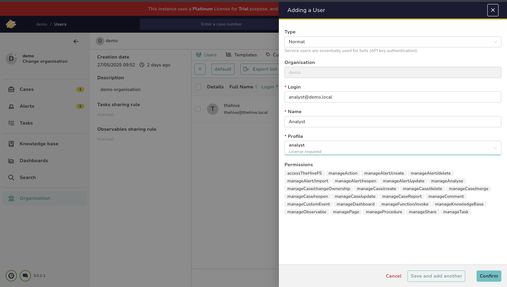

    *   After creating the user click the view icon to view users details and then in the section of api key generate an API key for this user.
   
  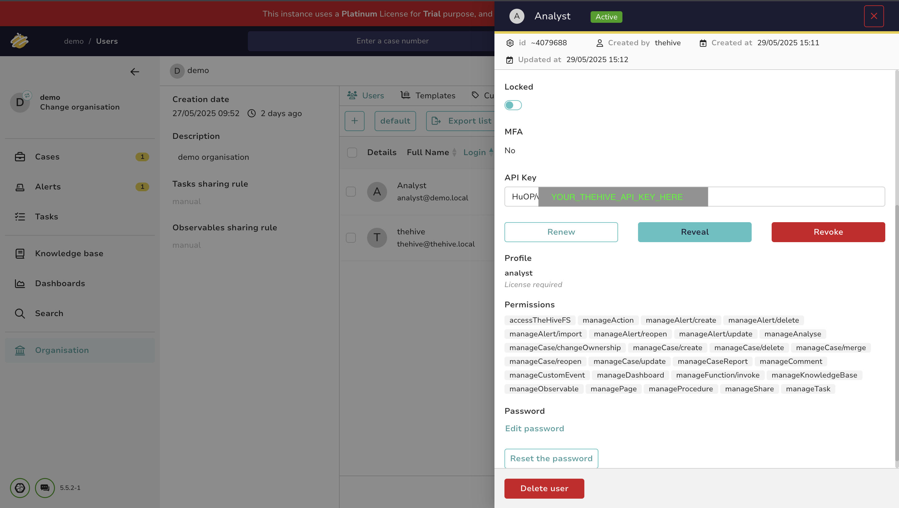
   **Note the API Key.** Placeholder: `YOUR_THEHIVE_API_KEY_HERE`.

### 2. Configure Wazuh Manager (Inside Docker Container)

Commands target the Wazuh manager Docker container.

#### Step 2.1: Identify the Wazuh Manager Container

List running Docker containers to find the Wazuh manager container ID/name (for our case is  `single-node-wazuh.manager-1`). Run the command below.
```bash
docker ps
```
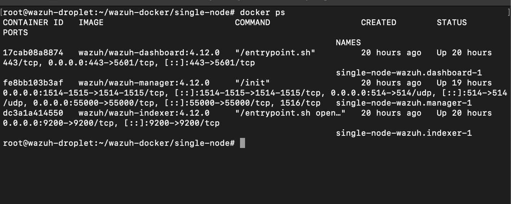

The name of wazuh manager container name is: `single-node-wazuh.manager-1`.

#### Step 2.2: Install TheHive Python Module in the Wazuh Container

The integration script requires `thehive4py`.
We have to access an interactive shell in the Wazuh manager container using the command below:
```bash
docker exec -it single-node-wazuh.manager-1 /bin/bash
```
Inside the container's shell, install the library:
```bash
# Inside the container's shell
/var/ossec/framework/python/bin/pip3 install thehive4py==1.8.1
```
Lets verify the installation within the container by running the following command in the shell:
```bash
# Inside the container's shell
/var/ossec/framework/python/bin/python3.10 -c "from thehive4py.api import TheHiveApi; print('TheHive4py is ready')"
# Exit the container shell
exit
```
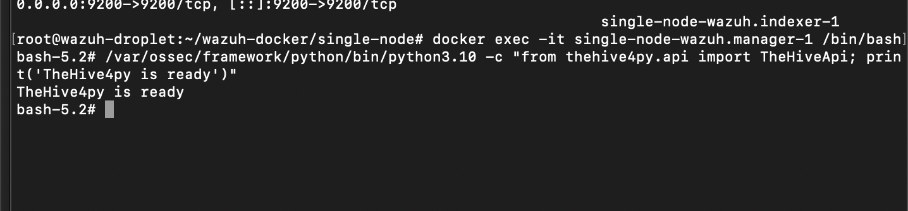

#### Step 2.3: Create Custom Integration Scripts on the Host

With reference to the wazuh blog post we are to create these scripts (`custom-w2thive.py`) and  (`custom-w2thive`) scripts  on our host machine. Notice on the python script i have set `cert=False` because this is a test environment and we are using self signed certificate. In the prodeuction envronment this is not recommended.

**`custom-w2thive.py`** (Python Integration Script)
```python
#!/var/ossec/framework/python/bin/python3
import json
import sys
import os
import re
import logging
import uuid
from thehive4py.api import TheHiveApi
from thehive4py.models import Alert, AlertArtifact

#start user config

# Global vars

#threshold for wazuh rules level
lvl_threshold=0 # Default: forward all alerts. Adjust as needed.
#threshold for suricata rules level
suricata_lvl_threshold=3

debug_enabled = False # Set to True for verbose logging to integrations.log
#info about created alert
info_enabled = True

#end user config

# Set paths
pwd = os.path.dirname(os.path.dirname(os.path.realpath(__file__)))
log_file = '{0}/logs/integrations.log'.format(pwd)
logger = logging.getLogger(__name__)
#set logging level
logger.setLevel(logging.WARNING)
if info_enabled:
    logger.setLevel(logging.INFO)
if debug_enabled:
    logger.setLevel(logging.DEBUG)
# create the logging file handler
fh = logging.FileHandler(log_file)
formatter = logging.Formatter('%(asctime)s - %(name)s - %(levelname)s - %(message)s')
fh.setFormatter(formatter)
logger.addHandler(fh)


def main(args):
    logger.debug('#start main')
    logger.debug('#get alert file location')
    alert_file_location = args[1]
    logger.debug('#get TheHive url')
    thive_url = args[3] # expecting https://<your_thehive_ip_address>/thehive or http://<your_thehive_ip_address>:9000
    logger.debug('#get TheHive api key')
    thive_api_key = args[2]
    
    # Use cert=False for self-signed certificates (common in labs)
    thive_api = TheHiveApi(thive_url, thive_api_key, cert=False) 
    
    logger.debug('#open alert file')
    try:
        with open(alert_file_location, 'r') as f:
            lines = f.readlines()
            if not lines:
                logger.error(f"Alert file {alert_file_location} is empty.")
                return
            w_alert = json.loads(lines[-1])
    except json.JSONDecodeError as e:
        logger.error(f"Error decoding JSON from alert file {alert_file_location}: {e}")
        logger.error(f"Content attempted to parse: {lines[-1] if lines else 'No lines found'}")
        return
    except FileNotFoundError:
        logger.error(f"Alert file {alert_file_location} not found.")
        return


    logger.debug('#alert data')
    logger.debug(str(w_alert))
    logger.debug('#gen json to dot-key-text')
    alt = pr(w_alert,'',[])
    logger.debug('#formatting description')
    format_alt = md_format(alt)
    logger.debug('#search artifacts')
    artifacts_dict = artifact_detect(format_alt)
    alert = generate_alert(format_alt, artifacts_dict, w_alert)
    logger.debug('#threshold filtering')
    
    if 'rule' in w_alert and 'groups' in w_alert['rule'] and w_alert['rule']['groups'] == ['ids','suricata']:
        if 'data' in w_alert and 'alert' in w_alert['data'] and 'severity' in w_alert['data']['alert']:
            try:
                if int(w_alert['data']['alert']['severity']) <= suricata_lvl_threshold:
                    send_alert(alert, thive_api)
            except ValueError:
                logger.warning(f"Could not parse suricata severity: {w_alert['data']['alert']['severity']}")
        else: 
            if 'level' in w_alert['rule'] and int(w_alert['rule']['level']) >= lvl_threshold:
                 send_alert(alert, thive_api)
    elif 'rule' in w_alert and 'level' in w_alert['rule']:
        try:
            if int(w_alert['rule']['level']) >= lvl_threshold:
                send_alert(alert, thive_api)
        except ValueError:
            logger.warning(f"Could not parse rule level: {w_alert['rule']['level']}")
    else:
        logger.info(f"Alert did not meet forwarding criteria: {w_alert.get('rule', {}).get('id', 'N/A')}")


def pr(data,prefix, alt):
    for key,value in data.items():
        if isinstance(value, dict): 
            pr(value,prefix+'.'+str(key),alt=alt)
        else:
            alt.append((prefix+'.'+str(key)+'|||'+str(value)))
    return alt


def md_format(alt,format_alt=''):
    md_title_dict = {}
    for now in alt:
        now = now[1:] 
        parts = now.split('|||')
        key_path = parts[0]
        dot = key_path.find('.')
        
        if dot == -1:
            main_key = key_path
        else:
            main_key = key_path[0:dot]
            
        if main_key in md_title_dict:
            md_title_dict[main_key].append(now)
        else:
            md_title_dict[main_key] = [now]
            
    for main_key in sorted(md_title_dict.keys()): 
        format_alt += '### '+main_key.capitalize()+'\n'+'| key | val |\n| ------ | ------ |\n'
        for item_str in md_title_dict[main_key]:
            key,val = item_str.split('|||')[0],item_str.split('|||')[1]
            format_alt += '| **' + key + '** | ' + val + ' |\n'
    return format_alt


def artifact_detect(format_alt):
    artifacts_dict = {}
    artifacts_dict['ip'] = re.findall(r'(?:[0-9]{1,3}\.){3}[0-9]{1,3}',format_alt)
    artifacts_dict['url'] =  re.findall(r'http[s]?://(?:[a-zA-Z]|[0-9]|[$-_@.&+]|[!*\(\),]|(?:%[0-9a-fA-F][0-9a-fA-F]))+',format_alt)
    artifacts_dict['domain'] = []
    for now_url in artifacts_dict['url']: 
        try:
            artifacts_dict['domain'].append(now_url.split('//')[1].split('/')[0].split(':')[0]) 
        except IndexError:
            logger.warning(f"Could not parse domain from URL: {now_url}")
            
    artifacts_dict['hash'] = re.findall(r'\b[A-Fa-f0-9]{32}\b|\b[A-Fa-f0-9]{40}\b|\b[A-Fa-f0-9]{64}\b', format_alt)
    return artifacts_dict


def generate_alert(format_alt, artifacts_dict, w_alert):
    sourceRef = str(uuid.uuid4())[0:6] 
    artifacts = []

    agent_name = w_alert.get('agent', {}).get('name', 'no_agent_name')
    agent_id = w_alert.get('agent', {}).get('id', 'no_agent_id')
    agent_ip = w_alert.get('agent', {}).get('ip', 'no_agent_ip')

    for key, value_list in artifacts_dict.items():
        for val in set(value_list): 
            if val: 
                artifacts.append(AlertArtifact(dataType=key, data=val))
                
    alert_title = w_alert.get('rule', {}).get('description', 'Wazuh Alert')
    rule_id = w_alert.get('rule', {}).get('id', 'no_rule_id')

    tags = [
        'wazuh', 
        f'rule_id={rule_id}',
        f'agent_name={agent_name}',
        f'agent_id={agent_id}'
    ]
    if agent_ip and agent_ip != 'no_agent_ip': 
        tags.append(f'agent_ip={agent_ip}')


    alert = Alert(title=alert_title,
              tlp=2, 
              tags=tags,
              description=format_alt,
              type='wazuh_alert', 
              source='wazuh',    
              sourceRef=sourceRef,
              artifacts=artifacts)
    return alert


def send_alert(alert, thive_api):
    try:
        response = thive_api.create_alert(alert)
        if response.status_code == 201:
            logger.info(f"Successfully created TheHive alert: ID {response.json()['id']}, SourceRef: {alert.sourceRef}")
        else:
            logger.error(f"Error creating TheHive alert ({alert.sourceRef}): {response.status_code} - {response.text}")
    except Exception as e:
        logger.error(f"Exception during TheHive alert creation ({alert.sourceRef}): {e}")


if __name__ == "__main__":
    if len(sys.argv) < 4:
        err_msg = "Error: Missing arguments. Usage: {} <alert_file_location> <thehive_api_key> <thehive_url>".format(sys.argv[0])
        try:
            logger.error(err_msg)
        except NameError: 
            print(err_msg, file=sys.stderr)
        sys.exit(1)

    try:
       logger.info('Starting custom-w2thive integration script.') 
       main(sys.argv)
       logger.info('Finished custom-w2thive integration script.') 
    except Exception as e:
       logger.exception(f"Unhandled exception in custom-w2thive: {e}")
```

**`custom-w2thive`** (Shell Wrapper Script)
```bash
#!/bin/sh
# Copyright (C) 2015-2022, Wazuh Inc.
# Created by Wazuh, Inc. <info@wazuh.com>.
# This program is free software; you can redistribute it and/or modify it under the terms of GPLv2

WPYTHON_BIN="framework/python/bin/python3"
SCRIPT_PATH_NAME="$0" 

DIR_NAME="$(cd "$(dirname "${SCRIPT_PATH_NAME}")" && pwd -P)" 
SCRIPT_NAME="$(basename "${SCRIPT_PATH_NAME}")"

if [ -z "${WAZUH_PATH}" ]; then
    if [ "${DIR_NAME}" = "/var/ossec/integrations" ]; then
        WAZUH_PATH="/var/ossec"
    else
        case ${DIR_NAME} in
            */active-response/bin | */wodles*)
                WAZUH_PATH="$(cd "${DIR_NAME}/../.." && pwd)"
            ;;
            */bin)
                WAZUH_PATH="$(cd "${DIR_NAME}/.." && pwd)"
            ;;
            *)
                WAZUH_PATH="$(cd "${DIR_NAME}/.." && pwd)"
            ;;
        esac
    fi
fi

PYTHON_SCRIPT="${DIR_NAME}/${SCRIPT_NAME}.py" 

if [ -z "${WAZUH_PATH}" ]; then
    echo "Error: WAZUH_PATH could not be determined." >&2
    exit 1
fi

WAZUH_PYTHON_INTERPRETER="${WAZUH_PATH}/${WPYTHON_BIN}"

if [ ! -x "${WAZUH_PYTHON_INTERPRETER}" ]; then
    echo "Error: Python interpreter not found or not executable at ${WAZUH_PYTHON_INTERPRETER}" >&2
    exit 1
fi

if [ ! -f "${PYTHON_SCRIPT}" ]; then
    echo "Error: Python script not found at ${PYTHON_SCRIPT}" >&2
    exit 1
fi

"${WAZUH_PYTHON_INTERPRETER}" "${PYTHON_SCRIPT}" "$@"
```

#### Step 2.4: Copy Scripts to the Wazuh Manager Container

Use `docker cp` to copy these files into `/var/ossec/integrations/` in the container. (Ensure scripts are in the host's current directory or adjust path).
```bash
docker cp ./custom-w2thive.py single-node-wazuh.manager-1:/var/ossec/integrations/custom-w2thive.py
docker cp ./custom-w2thive single-node-wazuh.manager-1:/var/ossec/integrations/custom-w2thive
```

#### Step 2.5: Set Permissions and Ownership in the Container

Access an interactive shell in the container:
```bash
docker exec -it single-node-wazuh.manager-1 /bin/bash
```
Then, run these commands inside the container's shell:
```bash
# Inside the container's shell
chown root:root /var/ossec/integrations/custom-w2thive.py
chown root:root /var/ossec/integrations/custom-w2thive
chmod 755 /var/ossec/integrations/custom-w2thive.py
chmod 755 /var/ossec/integrations/custom-w2thive
# Exit the container shell
exit
```


#### Step 2.6: Configure Wazuh's `ossec.conf`

1. Prepare `ossec.conf`. Replace placeholders with your TheHive server IP/hostname and API key.
    ```xml
    <ossec_config>

      <integration>
        <name>custom-w2thive</name>
        <hook_url>https://<YOUR_THEHIVE_SERVER_IP_OR_HOSTNAME>/thehive</hook_url> <!-- Or http://<IP>:9000 -->
        <api_key>YOUR_THEHIVE_API_KEY_HERE</api_key>
        <alert_format>json</alert_format>
      </integration>

    </ossec_config>
    ```
    **`hook_url`:** Must be reachable from the Wazuh Docker container.

2.  **Copy `ossec.conf` to container:** 
    ```bash
    docker cp ./ossec.conf single-node-wazuh.manager-1:/var/ossec/etc/ossec.conf
    ```

#### Step 2.7: Restart Wazuh Manager

Restart the Wazuh manager service for changes to take effect.
```bash
# Ensure you are in the directory containing your Wazuh docker-compose.yml 
# (e.g., wazuh-docker/single-node/)
docker-compose restart single-node-wazuh.manager-1
```

### 3. Testing the Integration

1.  **Generate a Wazuh Alert:** Trigger an event on a monitored agent to generate an alert.
2.  **Check Wazuh Logs:**
    *   Monitor `ossec.log` for integration errors:
        ```bash
        docker exec single-node-wazuh.manager-1 tail -f /var/ossec/logs/ossec.log
        ```
    *   Check the custom integration's log:
        ```bash
        docker exec single-node-wazuh.manager-1 tail -f /var/ossec/logs/integrations.log
        ```
3.  **Check TheHive:**
    * Log into TheHive and navigate to "Alerts".
      *   A new alert from Wazuh should appear. 
    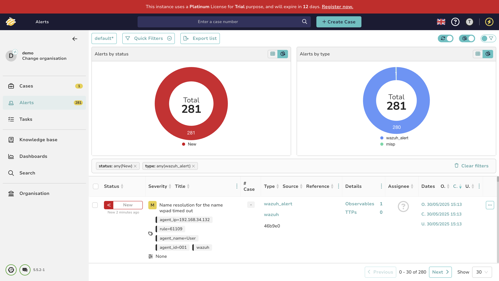
    * You can view a preview of the alert:
    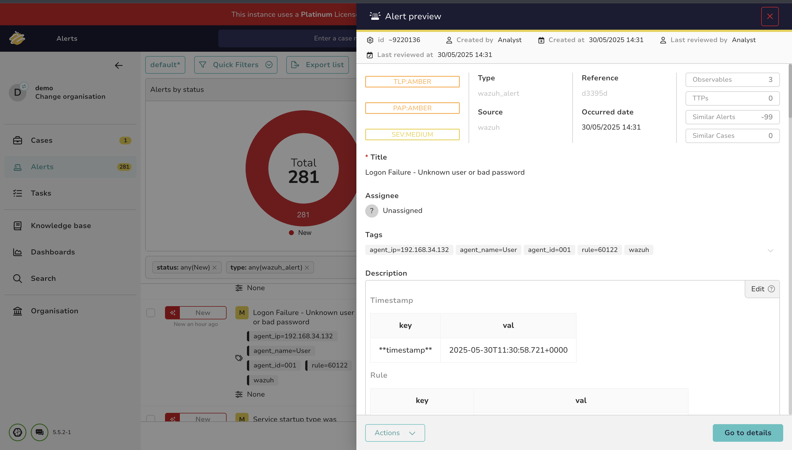
      *   And examine its details:
    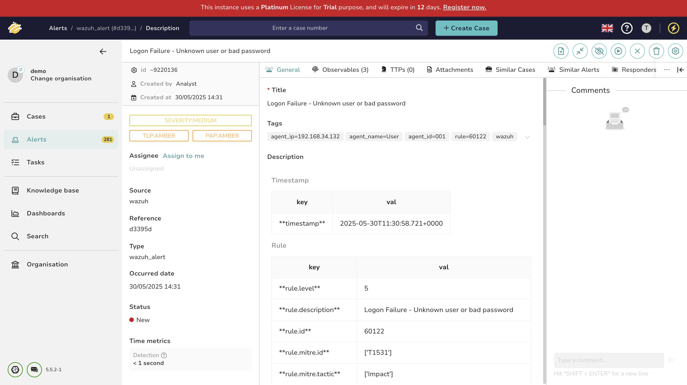
  
      *   Within the alert, you can inspect the extracted observables:
    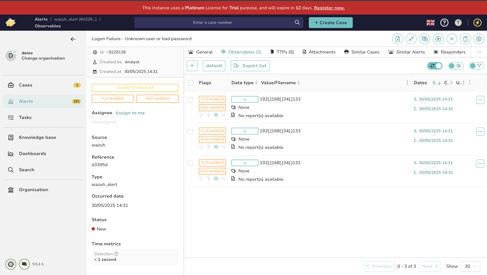
      *   And preview a specific observable:
    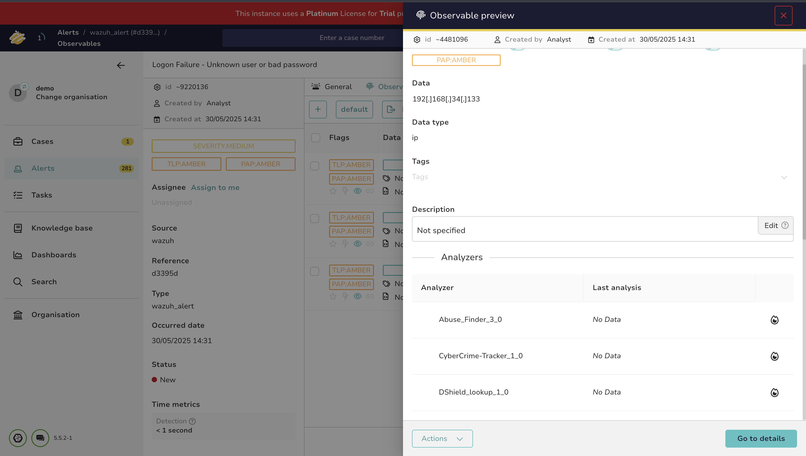
  
      *   To leverage the Cortex integration (from Day 2), select an observable and run available analyzers:
    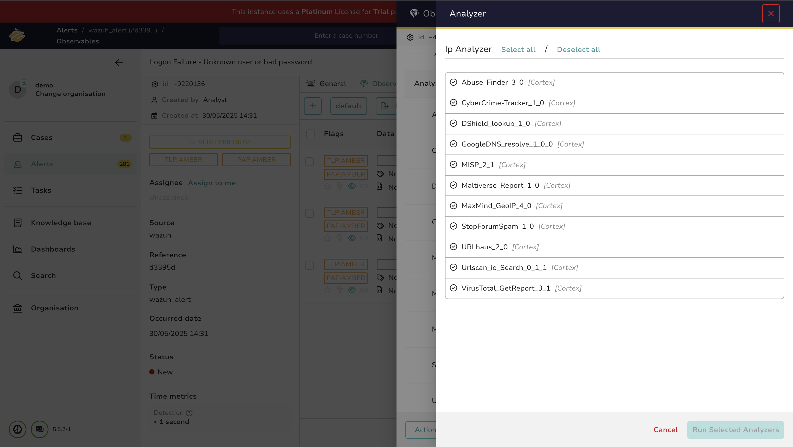
      *   The analysis report from Cortex (e.g., VirusTotal) will then be displayed within TheHive:
    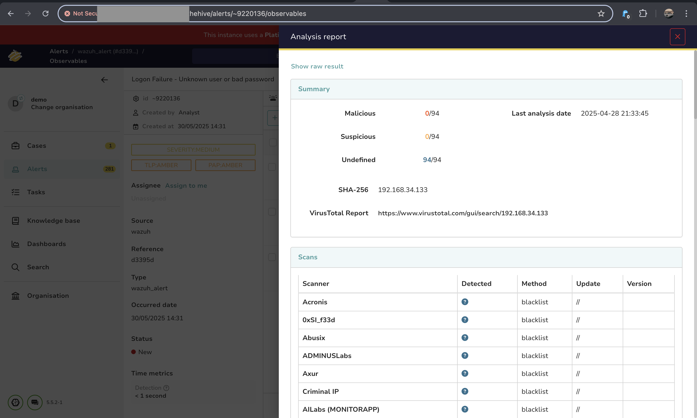

## 🔄 Workflow

This integration automates alert flow:
1.  Wazuh detects events and generates alerts.
2.  `custom-w2thive` forwards alerts to TheHive.
3.  The Python script creates alerts in TheHive using its API (`cert=False` handles self-signed certs).
4.  Analysts triage Wazuh alerts directly in TheHive.

## 📌 Summary of Achievements for Day 3

- Integrated Dockerized Wazuh manager with TheHive.
- Adapted integration steps for Docker: using `docker exec` for in-container commands and `docker cp` for file transfers.
- Utilized provided Python and shell scripts for the integration.
- Configured `ossec.conf` inside the container for the new integration.
- Tested alert flow from Wazuh to TheHive.

## 🔍 What's Next

- Deeper dive into TheHive case management with Wazuh alerts, using Cortex analyzers, and MISP correlation.

Stay tuned for the next episode! 